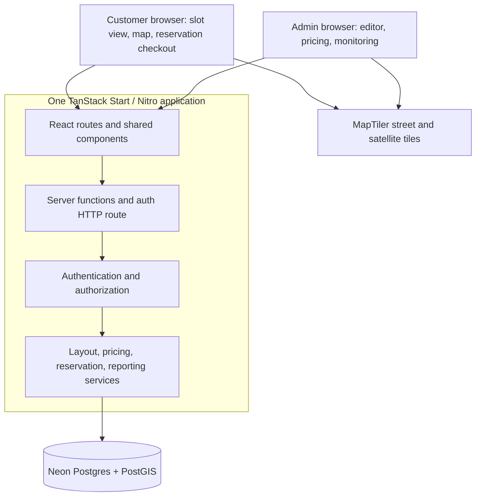

# Ketaon Fair — Tech Stack and System Architecture

Date: 17 November 2026  
Status: Proposed architecture for the [MVP](./mvp.md), not an implementation report

Implementation status and next tasks: [Progress tracker](./progress.md).

## 1. Architecture decision

Use one full-stack TanStack Start application containing the customer booking portal, authenticated admin dashboard, application services, and HTTP endpoints. Store geographic inventory and reservations in Neon Postgres with PostGIS.

Current priority: complete the booking flow first, then the admin dashboard and prototype verification. Payment integration is deferred. Checkout creates a persisted reservation and reference with no payment collected. Midtrans Snap remains the intended later integration; its design below is planning context, not a prototype dependency. Do not implement payment stubs, provider tables/routes, or scheduler infrastructure merely to prepare for that phase.

This is a modular monolith. A separate backend service, map server, Redis deployment, and realtime service are unnecessary for the initial demo. Database transactions own allocation correctness; periodic refresh only improves how current the UI appears.

## 2. Existing repository versus planned stack

Repository observations on 17 November 2026:

- `package.json` already includes React 19, TanStack Start/Router/Query/Table, TypeScript, Vite, Nitro, Tailwind CSS, Better Auth, Zustand, and the Neon serverless driver.
- `components.json` contains shadcn configuration. This does not establish a complete component library.
- `src/db.ts` contains a Neon HTTP query helper. It does not implement booking transactions.
- `src/lib/auth.ts` enables Better Auth email/password and TanStack cookies, but has no persistent database adapter or admin authorization configuration.
- `db/init.sql` is a todo demo schema. There is no booking schema in that file.
- `vite.config.ts` uses Nitro. No hosting provider or deployed runtime has been verified for this architecture.

Installed packages and scaffold files are not proof of working integrations. Keep the repository lockfile as the version reference; check compatibility when adding the planned packages.

| Layer                                | Technology / decision                                                  | Current position and purpose                                                             |
| ------------------------------------ | ---------------------------------------------------------------------- | ---------------------------------------------------------------------------------------- |
| Application                          | React + TypeScript + TanStack Start                                    | Existing scaffold; shared customer/admin application.                                    |
| Routing                              | TanStack Router                                                        | Existing; portal, admin, auth, webhook, and job routes.                                  |
| Server operations                    | TanStack Start server functions and server routes                      | Existing framework; implement authenticated services and integration endpoints.          |
| Server-state cache                   | TanStack Query                                                         | Existing; availability, orders, metrics, invalidation, and polling.                      |
| Client selection                     | Zustand                                                                | Existing; shared selected IDs and view state, never authoritative availability.          |
| Styling and components               | Tailwind CSS + shadcn/ui + Lucide                                      | Existing packages/config; create reusable form, table, status, and dialog components.    |
| Admin tables                         | TanStack Table                                                         | Existing; pricing, inventory, and order filtering.                                       |
| Map renderer                         | MapLibre GL JS + `react-map-gl/maplibre`                               | Add; clickable GeoJSON inventory and geographic context.                                 |
| Basemap                              | MapTiler streets + satellite layer switcher                            | Proposed provider; key, local coverage, attribution, and usage limits need verification. |
| Layout drawing                       | Terra Draw + `terra-draw-maplibre-gl-adapter`                          | Add; edit source rows and approved-area geometry.                                        |
| Geometry preview                     | Focused Turf.js modules                                                | Add; row slicing, distances, and draft generation helpers.                               |
| Authoritative spatial validation     | PostGIS                                                                | Enable in the chosen database; validate footprints and approved areas.                   |
| Database                             | Neon managed PostgreSQL                                                | User-selected; one store for inventory, orders, auth, and audit records.                 |
| Schema and migrations                | Drizzle ORM + Drizzle Kit                                              | Add; typed relational queries and committed migrations, with SQL for spatial operations. |
| Transaction driver                   | Neon serverless `Pool`/`Client` with Drizzle's Neon serverless adapter | Driver installed; add interactive transaction path for checkout and admin mutations.     |
| Authentication                       | Existing Better Auth, persisted in Neon                                | Complete adapter, migrations, sessions, and server-assigned admin role.                  |
| Input validation                     | Zod                                                                    | Add; server-validated IDs, quotes, money, dimensions, and geometry payload limits.       |
| Payment — later phase                | Midtrans Snap, starting with Sandbox                                   | Deferred; not installed/configured or required for the prototype.                        |
| Runtime                              | Node-compatible Nitro deployment                                       | Preserve current build approach; hosting provider remains open.                          |
| Payment reconciliation — later phase | Host scheduler and authenticated reconciliation route                  | Deferred with payments. Prototype reservations do not automatically expire.              |
| Analytics                            | PostgreSQL aggregate queries; simple React/SVG chart                   | Build in app; no separate analytics service.                                             |
| Verification                         | Vitest + real test-branch PostgreSQL checks + Playwright               | Planned development tools for geometry, allocation, payment, and end-to-end flows.       |

MapLibre documents polygon click interactions, and Terra Draw lists its MapLibre adapter. These are rendering/drawing tools; the application still owns booth rules. [MapLibre example](https://maplibre.org/maplibre-gl-js/docs/examples/show-polygon-information-on-click/), [Terra Draw repository](https://github.com/JamesLMilner/terra-draw).

Neon supports the PostGIS extension. The proposed schema therefore does not require a separate GIS database. [Neon PostGIS documentation](https://neon.com/docs/extensions/postgis).

## 3. System boundaries



TanStack server functions handle app-internal operations. The existing auth HTTP route remains in scope; payment webhook and scheduled-job routes are deferred. Both call the same services and enforce their own authorization boundary. [Server functions](https://tanstack.com/start/latest/docs/framework/react/guide/server-functions), [server routes](https://tanstack.com/start/latest/docs/framework/react/guide/server-routes).

### Proposed code organization

Follow the repository [engineering instructions](../AGENTS.md) for naming, module boundaries, and TanStack directory-based routing. The route tree there preserves `/` for the event landing page, `/booking` for customer booking, and `/admin` for the dashboard. Create proposed child pages only when their features are implemented.

```text
src/
  routes/                  TanStack directory routes with thin page/layout modules
  components/ui/           Shared controls and status patterns
  features/
    event-landing/         Event landing page content
    event-management/      Event setup and booking lifecycle
    event-layout/          Map editor, stretches, gaps, generation
    slot-inventory/        Slot browser, map layers, feature-owned selection store
    slot-pricing/          Bulk pricing and individual overrides
    booking-checkout/      Guest details, quote review, reservation UI
    booking-orders/        Status page and admin order monitoring
    booking-analytics/     Reservation metrics, route breakdown, booking chart
  server/
    auth/                  Session checks and admin permissions
    db/                    Drizzle schema, database clients, migrations integration
    services/              Authoritative application operations
    payments/              Deferred Midtrans adapter and status processing
    jobs/                  Deferred payment reconciliation
  shared/                  Schemas, DTOs, money and geometry types
db/
  migrations/              Application and auth migrations
  seeds/                   Explicitly illustrative demo fixture
```

This tree is a proposed destination. Do not treat it as files already present. Server modules must not be imported into browser bundles.

## 4. GIS and layout architecture

### Data and coordinate conventions

- Exchange map geometry as GeoJSON in WGS84 longitude/latitude order.
- Store rows as PostGIS lines and approved footprints/slots as PostGIS polygons with SRID 4326.
- Store frontage start/end distances and dimensions separately as exact integer millimeters. Convert to meters for display and geometry routines.
- Dimensions and prices both support a common default with per-slot exceptions. Keep stored base frontage/depth and nullable individual overrides; derive effective dimensions from the override when present. Do not infer price from size.
- Record whether dimensions are illustrative or field-measured. Coordinates alone cannot establish measurement accuracy.
- Give each row a fixed direction and an explicit footprint side. Map rotation never changes numbering or depth direction.
- Use a suitable local metric projection for footprint construction and area operations; choose it after confirming the event location. Use geography/geodesic measurement where appropriate. Never interpret longitude/latitude differences as meters.

### Basemaps, overlays, and maximum zoom

Satellite support is a confirmed requirement. Use a Street/Satellite basemap control inside map view; keep it separate from the Slot/Map presentation control. Use the same inventory IDs and GeoJSON overlays in the booking portal and admin editor.

Proposed display configuration is `maxZoom: 24`, with event/layout bounds on initial entry and explicit fit/focus actions. MapLibre documents a map zoom range up to 24 and a default maximum of 22. Verify the chosen setting with the installed version and real device rendering before claiming slot-level usability. [MapLibre map options](https://maplibre.org/maplibre-gl-js/docs/API/type-aliases/MapOptions/).

Treat display zoom and source tile zoom separately. Read the source's actual zoom range from provider metadata rather than requesting nonexistent tiles. MapLibre can reuse tiles beyond their source maximum; this magnifies imagery without creating additional ground detail. [MapLibre source specification](https://maplibre.org/maplibre-style-spec/sources/).

MapTiler currently lists satellite tiles up to zoom 22, but native imagery resolution varies by location. The actual site's imagery and positional accuracy still require inspection. This does not prevent drawing independent vector slots at display zoom 24. [MapTiler satellite reference](https://docs.maptiler.com/schema-raster/satellite/).

Implementation requirements:

- Keep display zoom settings, basemap identifiers, and source configuration centralized in a descriptive client-safe map configuration module.
- Preserve viewport, selection, filters, and draft source geometry independently of the active map style. Availability refresh must not trigger a camera reset.
- Keep inventory/exclusion layers above the basemap. If switching full styles, restore custom sources/layers, feature selection, and drawing tools after style loading without duplicating handlers or discarding edits.
- Configure geometry detail/simplification and source zoom for meter-scale footprints. Do not set a layer visibility maximum that hides slots before the map's display cap. Validate actual rendered footprints and hit detection at the proposed close zoom.
- Fit filtered available inventory with padding and a zoom cap. Focus a single slot using its bounds; ensure details panels do not cover it. Handle an empty result explicitly.
- Keep slot dimensions geographic, not screen-sized. Use label/outline contrast suitable for photography and retain keyboard/list access.
- Handle satellite errors separately from order/inventory failures; offer street tiles or slot view without discarding the selection. Show required map/provider attribution.
- Keep physical edits confined to the permitted draft workflow; changing style or zoom cannot change publication/booking restrictions.

### Draft generation pipeline

1. Admin edits source rows, approved intervals, footprint boundaries, dimensions, and exclusions.
2. Client previews valid uninterrupted intervals with Turf; `lineSliceAlong` is suitable for extracting distance-based row segments. [Turf reference](https://turfjs.org/docs/api/lineSliceAlong).
3. Subtract exclusion intervals before allocating slot frontage. For uniform generation, use integer division by the default width. For a mixed-size draft, allocate an ordered sequence using each slot's effective width and accumulate its end distance; do not calculate positions as slot index times one shared width. Track the actual remainder and reject overflow.
4. Construct each slot footprint from its frontage segment and depth. Split difficult corners into separate stretches rather than allowing self-intersections.
5. Send source parameters and expected draft revision to the server. The server recomputes canonical slot geometry and price defaults; it does not trust client polygons or totals.
6. Validate positive dimensions, interval bounds, approval, exclusion avoidance, polygon validity, containment, and overlap. Shared boundaries are allowed; positive-area interior overlap is not.
7. Save a complete generation atomically. Reject stale revisions instead of overwriting another admin edit.
8. Publish only after validation. A targeted dimension override preserves IDs, codes, and prices while reflowing and validating affected slots within that stretch. Full regeneration retires/replaces draft slots and requires a preview warning about discarded size/price overrides.

Use PostGIS validity, coverage, and spatial-intersection operations through parameterized SQL. Apply an explicit metric tolerance chosen and tested for the local layout; do not silently tolerate overlapping space. Add GiST indexes to spatial columns used in validation.

For individual resize, lock the event and affected draft records, check the expected revision and layout-edit eligibility, recompute the changed slot and following intervals in the same uninterrupted stretch, and validate all affected footprints before committing. If they do not fit, roll back; explicit draft removal is a separate reviewed action. A depth override changes the footprint without automatically shifting frontage intervals. Default changes do not silently resize generated inventory, and clearing an override must run the same validation.

### Publication and identity

Allow one active published layout per event. Publishing locks the event record and checks there has been no reservation. Checkout takes the same event lock before checking layout revision and setting `booking_started_at`.

Once `booking_started_at` is set, all geometry, codes, dimensions, slot membership, and layout replacement are frozen for that event. This intentionally limits post-reservation editing in the MVP and prevents duplicated inventory across layout versions. Draft versions remain useful before bookings and for future events, not for bypassing the freeze.

Blocking and pricing remain independent operations on unclaimed inventory. Event default pricing is a generation template; generated base prices and per-slot overrides follow the [MVP pricing rules](./mvp.md#53-pricing-and-price-generation).

## 5. Conceptual database schema

Implement booking, inventory, auth, and audit records for the prototype. The two payment records explicitly marked below belong to a later migration; do not create empty payment tables as a prerequisite for reservations.

| Record                        | Important fields and responsibility                                                                                                                                                                  |
| ----------------------------- | ---------------------------------------------------------------------------------------------------------------------------------------------------------------------------------------------------- |
| Better Auth tables            | Persisted user, session, account, and verification records managed through reviewed migrations.                                                                                                      |
| Admin role assignment         | Server-provisioned role tied to the auth user; no public admin signup or client-editable role.                                                                                                       |
| `events`                      | ID, slug, name, dates, timezone, booking window, sales state, default price/dimensions, active layout ID, `booking_started_at`.                                                                      |
| `layout_versions`             | Event ID, version, draft/published/retired state, revision, approval metadata, published time.                                                                                                       |
| `routes`                      | Layout ID, name, display order; organizational grouping.                                                                                                                                             |
| `booth_rows`                  | Route ID, line geometry, fixed direction, footprint side, label.                                                                                                                                     |
| `approved_stretches`          | Row ID, start/end mm, default frontage/depth mm, approved polygon, approval state and note.                                                                                                          |
| `exclusions`                  | Row ID, start/end mm, reason, optional polygon for physical obstruction checks.                                                                                                                      |
| `slots`                       | Stable ID, event/layout/stretch IDs, code, order/interval, stored base frontage/depth mm, nullable dimension overrides, polygon, base price, nullable price override, blocked flag/reason, revision. |
| `guest_sessions`              | Hashed private token, expiry, session metadata; authorizes guest order access.                                                                                                                       |
| `orders`                      | Event/guest IDs, reference, customer snapshot, reserved/cancelled state, total IDR, idempotency key, reserved time, cancellation actor/reason/time; explicit payment state `not_integrated`.         |
| `order_items`                 | Order/slot IDs plus immutable code, route, dimensions, footprint, and unit price snapshots.                                                                                                          |
| `reservations`                | Order ID, reserved/released state, reserved and released timestamps. No automatic deadline in the prototype; future expiry is a separate policy/migration.                                           |
| `slot_claims`                 | Reservation/slot IDs, reserved state, nullable release time; exclusive ownership. Held/sold transitions are added with payments.                                                                     |
| `payment_attempts` — deferred | Future order/provider references, attempt creation/status, token/deadline, next check time. Not required in the prototype schema.                                                                    |
| `payment_events` — deferred   | Future deduplication, verified notification evidence, processing outcome. Not required in the prototype schema.                                                                                      |
| `audit_logs`                  | Actor, event/entity IDs, operation, previous/new values, timestamp, request correlation ID.                                                                                                          |

### Database invariants

- All slot codes are unique within a layout. Provider order ID uniqueness is a later payment invariant.
- One logical checkout idempotency key per guest session yields one order. Reusing it with a different payload is a conflict.
- A partial unique index on `slot_claims(slot_id)` where `released_at IS NULL` prevents more than one active reservation. Retain this invariant when paid ownership is added.
- Released claims remain as history. The prototype has no automatic expiry cleanup; cancellation releases all of one booking's active claims atomically.
- Positive base/override price and dimension checks are enforced in the database as well as the server. A slot interval must match its effective frontage; persist interval/geometry changes atomically and reject invalid mixed-size layouts.
- Store whole IDR amounts as integers, never floating-point currency. Enforce a supported upper bound so API number serialization remains exact.
- Store timestamps as `timestamptz`; render using the event timezone, proposed `Asia/Jakarta` for the demo.
- Foreign keys and event/layout consistency checks prevent cross-event orders or references to another event's slots. Use composite keys where necessary, not UI filters alone.
- Availability is derived from publication, blocking, and active claims. Do not maintain a second independently writable `slots.status` cache.

For the prototype, displayed availability is available, reserved, or blocked. Reserved means an active persisted claim, not paid ownership. Block mutations require no active claim, keeping the three states mutually exclusive. Held/sold/payment-review states are introduced only with payment integration.

## 6. Reservation and pricing transactions

### Database transport

Use an interactive transaction for operations that lock rows, inspect results, and conditionally write related records. The existing HTTP helper cannot be used as unrelated HTTP `BEGIN`, query, and `COMMIT` requests. Neon documents HTTP for single/non-interactive transactions and `Pool`/`Client` over WebSockets for interactive transactions. [Neon driver documentation](https://neon.com/docs/serverless/serverless-driver).

Use Drizzle's Neon serverless integration for this transaction path, with parameterized SQL for PostGIS and locking where needed. Scope connection acquisition/release to the hosting runtime and avoid keeping transactions open across network calls. [Drizzle Neon integration](https://orm.drizzle.team/docs/get-started/neon-new).

### Reservation flow

1. Validate the guest session, unique slot IDs, one-event constraint, contact fields, and idempotency key.
2. Begin a short transaction. Lock the event, then selected slots in stable ID order; related mutations follow the same order.
3. Check the booking window, published layout/revision, dimensions, blocking, and active claims. Prototype reservations do not expire automatically.
4. Resolve effective prices and compare the reviewed quote/revisions. Return a conflict without creating a booking if changed.
5. Insert the order, immutable items, reservation, and exclusive claims. Set order state `reserved`, payment state `not_integrated`, and event `booking_started_at`.
6. Commit everything together. Any unavailable slot or constraint conflict rolls back the entire selection.
7. Return the booking reference and private status data with "No payment collected". No external payment request occurs.

The unique index remains the final allocation guard. Retry only bounded, safe transaction conflicts with the same idempotency key. After a lost response, the same request recovers the original booking; it cannot create a second one.

### Prototype cancellation

Proposed admin-only operation: lock the event, affected slots, booking, and claims in the documented order; verify the booking is a prototype reservation with no payment integration; record cancellation reason/actor; release every active claim and mark the booking cancelled in one transaction. Repeating the cancellation returns its existing result. Retain immutable snapshots and the event's geometry freeze. Do not reuse this release rule for future pending/paid bookings without a separate policy.

### Pricing and blocking flow

Lock the event and target slots in the same order. Recheck claims and revisions inside the transaction. Update only eligible slots and record audit entries. Bulk application returns precise changed/skipped IDs and reasons; a preview does not guarantee later eligibility.

Price snapshots are set when the reservation is created. A change to the event template never updates existing slot bases automatically. Reserved slots reject base/override changes, and earlier snapshots remain unchanged after cancellation. Extend the protection to held/sold inventory when payments are added.

## 7. Payment processing and reconciliation

**Deferred phase.** This section preserves future integration requirements only. None of its provider calls, credentials, tables, endpoints, jobs, payment UI, or acceptance tests block the current prototype. Recheck provider documentation during implementation, define payment holds explicitly, and plan migration of existing prototype reservations without marking them paid automatically.

### Integration boundary

The server creates a Snap transaction with the recorded amount, stable item snapshots, unique provider order ID, allowed methods, and agreed expiry configuration. The browser receives only the scoped Snap token/redirect information. Keep the server key private. Snap creation and notification URLs must use the same Sandbox environment. [Midtrans integration guide](https://docs.midtrans.com/docs/snap-snap-integration-guide).

### Webhook handler

1. Validate the incoming payload and apply request size limits.
2. Verify the standard Snap notification signature using the exact supplied `order_id`, `status_code`, and `gross_amount` strings plus the private server key. Compare the SHA-512 digest safely.
3. Query provider status for authoritative processing, then compare the attempt, amount, currency, and environment with stored expectations.
4. Persist evidence and apply the transition in a short transaction using the common lock order. Confirm only if the order still owns every required claim.
5. Deduplicate processing and never regress a confirmed order to pending because of a delayed notification. Acknowledge only after processing or durable recording; failed work remains retryable.

Signature verification, provider status verification, and handling delayed notifications are covered by [Midtrans webhook documentation](https://docs.midtrans.com/docs/https-notification-webhooks). Browser callbacks only trigger a server refresh.

### Internal state mapping

Keep raw provider status, normalized payment state, order state, and claim state separate.

| Provider outcome                                         | Proposed application treatment                                                                                                        |
| -------------------------------------------------------- | ------------------------------------------------------------------------------------------------------------------------------------- |
| `pending`                                                | Payment pending; order awaits payment; claims remain held.                                                                            |
| `settlement`, or accepted card `capture`                 | Verified successful payment; confirm the order and convert all its claims to sold atomically. Honor fraud-status checks when present. |
| Definitive `deny`, `cancel`, or `expire`                 | Record the terminal failed/cancelled/expired result; release claims only after the attempt is safely terminal.                        |
| Unknown, challenged, inconsistent, or unavailable status | Needs review; retain claims and schedule another check.                                                                               |
| Refund, partial refund, chargeback, or other reversal    | Record the event and flag review; do not automatically resell the physical space.                                                     |

Releasing claims requires establishing that the complete checkout session and all related payment instruments can no longer accept payment. A failed method that still permits another attempt within Snap is insufficient. A verified rejection before any payable session was created can release its claims; ambiguous creation results cannot.

Provider statuses can change beyond initial success, so keep transition rules explicit rather than assigning a simplistic numeric status rank. [Midtrans transaction status cycle](https://docs.midtrans.com/docs/transaction-status-cycle).

### Expiry and uncertain creation

Snap page expiration is distinct from payment-method expiration. Configure the intended page/payment deadline, verify the chosen methods in Sandbox, and never release inventory merely because the page countdown elapsed. [Midtrans expiry reference](https://docs.midtrans.com/reference/expire-a-snap-session).

If token creation times out, the result is unknown: an external transaction may exist even if the application received no response. Keep the same provider order ID and claims, record `creation_unknown`, and reconcile. Do not blindly create another payable attempt.

A missing status response alone is not proof that no Snap session or payable instrument can exist. Retain uncertain claims until a documented, tested recovery path establishes the old session/attempt cannot accept payment. This deliberately favors inventory safety over rapid release; the admin attention list exposes the operational cost.

### Scheduled reconciliation

- Proposed cadence: every minute, process a bounded batch of due/uncertain attempts with retry backoff.
- Claim work with a database lease so overlapping job calls do not both process the same attempt.
- Make provider calls outside database locks, then re-lock and revalidate before applying results.
- Recheck pending orders, expired-looking holds, unknown creation results, and unprocessed durable payment events.
- Release only after a definitive safe outcome. Retain and flag uncertainty instead of guessing.
- Reuse the same reconciliation service for the admin refresh action and server-side order refresh.
- Record job heartbeat, last provider check, next retry, and actionable error details.

The job uses the authenticated server-to-server status endpoint. [Midtrans status API](https://docs.midtrans.com/reference/get-transaction-status).

### Late success after release

If a verified payment arrives after its original claims were released, create a paid exception and notify the admin through the attention list. Do not take slots from a newer order, automatically allocate alternatives, or count the original booking as confirmed. Resolution requires an explicit organizer policy outside this MVP.

## 8. Proposed application interfaces

### Page routes

| Path                              | Responsibility                                                                                        | Decision status                                                             |
| --------------------------------- | ----------------------------------------------------------------------------------------------------- | --------------------------------------------------------------------------- |
| `/`                               | Event landing page with event information and entry into booking.                                     | Confirmed by the user.                                                      |
| `/booking`                        | Customer inventory browser containing slot and map views and shared selection. Supports direct entry. | Confirmed by the user; upcoming portal implementation starts here.          |
| `/booking/checkout`               | Customer details, quote review, and reservation submission; no payment UI in the prototype.           | Proposed child route.                                                       |
| `/booking/orders/$bookingOrderId` | Private reservation status and no-payment notice. The path ID alone grants no access.                 | Proposed child route.                                                       |
| `/admin`                          | Authenticated organizer dashboard for slot management, pricing, analytics, and monitoring.            | Confirmed by the user; specific child routes remain implementation details. |

The `/booking` route owns the two inventory views; switching between them does not navigate to the event landing page or create a separate cart. Landing-page work and booking implementation have separate route ownership.

### Server boundaries

These are conceptual operations to implement, not existing endpoints.

| Boundary                     | Operations                                                                                                                              |
| ---------------------------- | --------------------------------------------------------------------------------------------------------------------------------------- |
| Public server functions      | Event details, published inventory, read-only quote.                                                                                    |
| Guest-owned server functions | Reserve selection and read private booking status; idempotent submission recovers lost responses.                                       |
| Admin server functions       | Event/draft/generation/publishing, price and size adjustment, blocking, reservation search/details, proposed cancellation, and metrics. |
| Existing auth route          | `/api/auth/*`, completed with persistence and role checks.                                                                              |
| External webhook — deferred  | Future `POST /api/payments/midtrans/notification`; do not implement for the prototype.                                                  |
| Scheduled job — deferred     | Future `POST /api/jobs/reconcile-payments`; no prototype scheduler prerequisite.                                                        |

Every admin function checks the server session and role. Every guest-owned operation checks the guest token/session, not just a reference or guessed order ID. A webhook uses its provider verification path, not an admin session.

## 9. Frontend data flow

- The `/booking` route loads event identity and published layout metadata independently of `/`. Load map/editor code on the client to avoid browser-only map APIs during SSR.
- TanStack Query fetches inventory, orders, and metrics through server boundaries. Use event/layout/revision in query keys and invalidate after relevant mutations.
- Zustand stores only selected IDs, selected view, and editor-local state. Derive displayed prices and statuses from current query results.
- Slot view and map consume one inventory dataset and selection store. Never run independent carts for the two views.
- Proposed visible-page refresh: inventory/dashboard every 15 seconds and private reservation status on entry or after a relevant action. No payment polling or provider calls occur in the prototype; payment-phase polling is designed later.
- Label stale data and show last refreshed time. Revalidate every checkout regardless of polling freshness.
- Use GeoJSON fill/line layers rather than one React DOM marker per slot. Highlight selected features and synchronize focus with the accessible list.
- On map failure, retain the slot browser. Map tiles and styles are display dependencies, not booking authorities.
- Cache static assets and approved geometry by revision where appropriate. Private orders, checkout, mutable inventory, and admin metrics must not be shared-cached across users or served as prerendered data.

## 10. Reporting and monitoring

Calculate prototype metrics from event-scoped reservations/claims and immutable order items. Available + reserved + blocked must equal published inventory in a consistent snapshot. Quoted reservation value uses active order/item snapshots, never current prices or a claim of collected revenue. Booking trends use `reserved_at` in the event timezone; cancellation history remains auditable.

Use structured, redacted logs for reservation submissions, conflicts, cancellations, layout/pricing changes, and application failures. Show booking activity and refresh state in the dashboard. There is no payment attention list, provider status refresh, scheduler heartbeat, or reconciliation job to implement in this phase.

Later payments add financial status, verified sales, provider exceptions, and job monitoring. Keep that reporting separate from prototype reservation values and migrate records explicitly.

## 11. Security and configuration

| Configuration                                          | Exposure                                                                                   |
| ------------------------------------------------------ | ------------------------------------------------------------------------------------------ |
| `DATABASE_URL`                                         | Server only; pooled application connection.                                                |
| Migration connection/configuration                     | Server/developer only; separate migration execution from app startup.                      |
| `BETTER_AUTH_SECRET`, `BETTER_AUTH_URL`                | Secret is server only; origin configured per environment.                                  |
| `MIDTRANS_SERVER_KEY`, environment selector — deferred | Not required for the prototype; server-only Sandbox configuration when integration begins. |
| Midtrans client key — deferred                         | Add only if the chosen later Snap mode needs it; never expose the server key.              |
| MapTiler browser key                                   | Public by necessity; restrict permitted origins and usage.                                 |
| Reconciliation job credential — deferred               | No prototype scheduler; add a server-only credential in the payment phase.                 |

Use secure, HttpOnly guest/admin cookies and appropriate SameSite settings. Store guest access tokens hashed at rest. Protect cookie-authenticated mutations against cross-site requests. Rate-limit reservation submissions and admin cancellation; add provider-refresh limits in the payment phase. Limit slot counts and geometry payload sizes. Public inventory responses contain no customer contacts, auth details, reservation-owner identifiers, or payment tokens.

Parameterize SQL, including spatial SQL. Redact payment secrets and unnecessary personal information from logs and notification evidence. A payment reference or public booking code is not an authorization credential.

## 12. Environments and deployment

| Environment       | Database / payment                                                    | Purpose                                                                                     |
| ----------------- | --------------------------------------------------------------------- | ------------------------------------------------------------------------------------------- |
| Local development | Isolated development branch, no payment integration                   | Build reservation/admin flows without provider keys or webhooks.                            |
| Shared demo       | Dedicated demo branch, illustrative inventory, no payment integration | Reviewer-accessible portal/admin with saved reservations and an explicit no-payment notice. |
| Live              | Separately configured live database/payment credentials               | Deferred until measurement, operating policy, and payment acceptance are resolved.          |

Keep the existing Nitro Node build as the baseline. Choose a host supporting the installed runtime, HTTPS, environment secrets, and database connectivity. Webhook reachability and reliable scheduled calls become requirements for the later payment phase. Vercel remains an alternative from the original conversation, subject to its adapter and scheduler constraints; it is not a verified deployment decision.

The prototype does not require expiry cleanup. When payment holds are introduced, do not use an in-process timer as their only cleanup mechanism on a host that can restart or suspend. Do not run schema migrations or reset demo data automatically on ordinary requests. Review migrations on an isolated branch before applying them to a shared environment.

Basemap account setup, local tile coverage, provider attribution, and hosting remain unverified prototype dependencies. Payment credentials and scheduler setup are deferred dependencies. Exact costs and hosting limits are outside this architecture decision.

## 13. Decision records

Evidence for these choices is the user brief and local scaffold. No comparable product screens or user testing were used. These are engineering/product judgments with the following trade-offs.

| Decision             | Alternatives considered                                          | Choice, reason, and trade-off                                                                                        |
| -------------------- | ---------------------------------------------------------------- | -------------------------------------------------------------------------------------------------------------------- |
| Backend boundary     | Separate API service / full-stack Start app                      | One app reduces integration work and fits the requested stack; UI and backend share deployment.                      |
| GIS stack            | Custom GIS editor / MapLibre with drawing and geometry libraries | Compose existing tools; the project must still implement frontage rules and validation.                              |
| Pricing model        | Rule engine / default plus explicit slot prices                  | Stored base plus optional override fits mostly uniform prices; default changes require an explicit bulk application. |
| Customer identity    | Mandatory account / guest session                                | Guest is proposed for demo speed; cross-device recovery is deferred and private session access must be implemented.  |
| Availability updates | Push realtime / periodic refresh                                 | Polling is enough for the initial demo; visible availability may lag, so reservation remains authoritative.          |
| Post-sale layout     | Migrate active versions / freeze geometry                        | Freeze after the first reservation; safer and simpler, but physical changes require a later workflow.                |
| Infrastructure       | Dedicated workers/queue / in-app services                        | Use the app and PostgreSQL for the prototype; scheduled payment reconciliation is deferred.                          |

Confidence is high that one full-stack application fits this prototype. Confidence in site accuracy, actual payment expiry settings, and operating policies remains unverified until field/provider tests and organizer decisions.

## 14. Implementation verification plan

- Unit-check integer interval subtraction, uniform and mixed-width counts/remainders, decimal-meter normalization, dimension override/reset and reflow, overflow rollback, independent effective pricing, and state transition rules.
- Exercise PostGIS validity/containment/collision checks against representative corners and access gaps.
- Run concurrent allocation tests against real PostgreSQL on an isolated test branch; assert the active-claim unique constraint and all-or-nothing selection behavior.
- Race price/block/publish changes against reservation, including stale revisions and deterministic locking.
- Test duplicate reservation submission, lost-response recovery, admin cancellation/release races, unchanged snapshots, and accurate reserved inventory/value counts.
- Verify the prototype works without payment configuration and never displays a paid/sold result.
- Deferred payment checks: provider timeouts, duplicate/out-of-order notifications, signature/amount validation, method expiry, unused sessions, reversals, and reconciliation races. They become acceptance criteria when that phase is implemented.
- Verify private booking ownership, forbidden admin access, and absence of secrets/PII in public GeoJSON and logs. Protected payment jobs are checked in their later phase.
- Verify both inventory views, mixed-price checkout, map failure fallback, mobile checkout, dashboard totals, and the illustrative-data labels.
- Verify street/satellite switching with overlays and unsaved editor work intact, source-aware tile requests, close-zoom slot hit detection, fit/focus actions, and stable viewport during availability refresh.
- Run the repository build, lint, type checking, and focused tests once corresponding code exists. This documentation task does not establish that those implementation checks pass.
